# **Securebank:** System Report

## Overview
SecureBank is a machine learning system prototype designed to detect potentially fraudulent financial transactions. The project focuses on building more than a standalone model: it implements the surrounding system components needed to prepare raw data, train a model, serve predictions, and monitor system activity after deployment.

The goal of the system is to classify incoming transactions as either legitimate or fraudulent using both transaction-level information and customer profile information. To support that goal, the system integrates multiple raw data sources, applies preprocessing and feature engineering, trains a fraud detection model, selects an operating threshold, and exposes the final workflow through a Dockerized Flask API.

This report documents the design decisions behind the SecureBank system. It explains how the system meets the project requirements, how the data pipeline was designed, why the final model configuration was selected, how performance was evaluated, and how the deployed service supports monitoring, error handling, and future model maintenance.

## System Description

SecureBank represents a financial institution that needs to detect fraudulent card transactions from operational data. In this setting, fraud detection is not only a modeling problem. The system must handle data from multiple sources, produce repeatable training datasets, serve predictions for new transactions, and create enough monitoring information for administrators to understand what the system is doing after deployment.

The main system requirement is to support reliable transaction-level fraud classification. A submitted transaction must be classified as either `legitimate` or `fraudulent`, but the system also needs the surrounding infrastructure required to keep that model useful over time. This includes dataset generation from updated data sources, retraining support, saved model metadata, and logs for monitoring system behavior. Because fraud is rare but costly, the system must also be evaluated using fraud-aware metrics such as precision, recall, F1, balanced accuracy, ROC AUC, and average precision rather than relying only on accuracy.

To address these requirements, the SecureBank system was designed as a small production-style machine learning service. It accepts raw customer, transaction, and fraud label data, generates a cleaned training dataset, trains a fraud detection model, registers a default model for inference, and exposes prediction through a Flask API. The final service is deployed inside Docker and can be tested through the provided bash scripts.

A major design goal was modularity. Instead of placing all logic inside one notebook or one Flask route, the system is separated into layers. The Flask application handles API routing, service classes manage endpoint-level behavior, orchestrators coordinate the training and prediction workflows, data modules handle preprocessing and validation, and model adapters handle model-specific feature preparation. This structure makes the system easier to test, debug, and extend because each component has a focused responsibility.

The system meets the minimum functional requirements through three main API workflows. The `/predict` endpoint accepts a transaction payload and returns a JSON prediction with the required `predict` field containing either `legitimate` or `fraudulent`. The `/create_dataset` endpoint allows an administrator to generate a new cleaned training dataset from the available raw data sources. The `/train_model` endpoint allows an administrator to train a new fraud detection model, evaluate candidate thresholds, save versioned model artifacts, and update the default model metadata used by the prediction service.

The system also supports monitoring through structured JSON logs. Dataset generation, training, preprocessing, and prediction workflows write timestamped log files under `securebank/logs/`. These logs capture request information, response metadata, workflow status, and errors when applicable. This provides a basic monitoring foundation for checking system activity, diagnosing failures, and supporting future online performance tracking.

The final model workflow uses both transaction and customer information. Transaction features include amount, merchant/category information, merchant location, and time-derived fields such as day of week, hour, month, and year. Customer features include profile fields such as state, sex, job, date of birth, and location coordinates. The preprocessing pipeline enriches incoming prediction requests by using `cc_num` to retrieve the corresponding customer profile before model-specific feature adaptation.

This system is designed as an initial AI-based fraud detection prototype for SecureBank. Rather than relying on manual review rules or a simple application-only workflow, the system introduces trained machine learning models, repeatable dataset generation, model versioning, and monitoring logs. Logistic regression was used as a simple experimental baseline, while gradient boosting was configured as the default model because it produced stronger fraud detection performance during experimentation.

In the latest training run, the tuned default gradient boosting model selected a probability threshold of `0.60`. On the validation split used for threshold selection, it achieved approximately `0.966` precision, `0.740` recall, and `0.838` F1. On the held-out test split, it achieved approximately `0.960` precision, `0.728` recall, and `0.828` F1. These results show that the system meets the project target of at least 70 percent precision and 70 percent recall while maintaining a strong balance between fraud detection and false positive control.

Overall, the SecureBank system provides a deployable and extensible fraud detection prototype. It meets the required prediction, dataset generation, training, Docker deployment, and logging capabilities while using a modular architecture that supports future improvement, additional models, retraining strategies, and production monitoring.

## Data Design
### Data Architecture and Pipeline Design

The SecureBank data pipeline was designed to separate general data preparation from model-specific feature engineering. This separation is important because all supported models need the same reliable transaction-level dataset, but different model families may require different feature representations. The system therefore processes data in two main stages: a shared preprocessing pipeline and model-specific adapters.

The shared preprocessing pipeline is responsible for preparing the raw data into a consistent and validated transaction-level format. The system begins with three raw sources: customer data, transaction data, and fraud labels. The raw data handler loads these files, normalizes transaction identifiers, attaches fraud labels to transaction records, removes duplicate transactions, and merges customer profile information onto transaction rows using `cc_num`. This merge is a key design step because the final fraud detection model is required to use both transaction-level information and customer-level context.

After the raw sources are merged, the preprocessing pipeline applies common cleaning and validation steps. Required fields such as `cc_num`, `amt`, `trans_date_trans_time`, and `is_fraud` are validated for training data, while incoming prediction payloads are checked against their required fields before inference. Optional missing values are filled with controlled defaults, while records missing required fields are removed. The pipeline also converts `trans_date_trans_time` into shared time-based features such as day of week, hour, minute, seconds, day of month, month, and year. These time features are created in the common preprocessing stage because they are useful across model types and were important during data exploration.

The second stage is model-specific adaptation. After preprocessing, each adapter converts the cleaned dataset into the feature format required by its model. The logistic regression adapter applies transformations suitable for a linear model, including categorical encoding, frequency encoding, numeric scaling, age creation, and prediction-time feature alignment. Scaling is included for logistic regression because linear models are sensitive to numeric feature magnitudes. The gradient boosting adapter uses similar cleaned inputs but does not require numeric scaling because tree-based models are less sensitive to feature scale. It focuses on categorical encoding, frequency encoding, derived features, and feature alignment.

This architecture creates a clean boundary between data correctness and model preference. The preprocessing pipeline ensures the data is valid, complete, and consistently shaped, while the adapters control how that data is represented for each model. This makes the system easier to test and extend because a new model can be added by creating a new adapter without rewriting the raw data loading or preprocessing workflow.

### Data Analysis and Feature Insights
#### Raw Data Analysis

The raw data analysis focused on identifying distribution patterns, missingness concerns, and feature behavior before the preprocessing pipeline was finalized. This step was important because SecureBank uses multiple data sources, and the final model depends on both transaction level behavior and customer context. The goal was not only to find predictive features, but also to identify fields that could introduce skew, noise, or operational risk if handled incorrectly.

One of the clearest findings was that transaction activity is not evenly distributed across time. Transaction counts vary by day of week, hour, and month. Activity is higher on Sunday and Monday, lower around the middle of the week, and noticeably higher during the afternoon and evening hours. Monthly volume also increases sharply in December. These patterns suggest that transaction timing is meaningful and should be represented explicitly instead of leaving the raw timestamp as a single field. This directly supported converting `trans_date_trans_time` into features such as `day_of_week`, `hour`, `day_date`, `month_date`, and `year_date`.

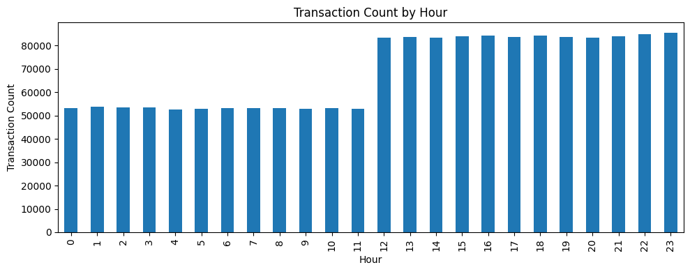

**Figure 1:** Transaction count by hour. Transaction volume is higher from midday through late evening, supporting the use of hour as a model feature.

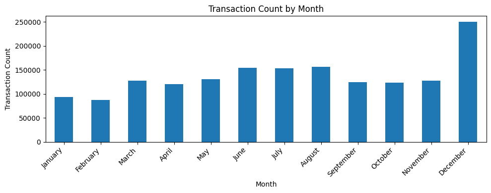

**Figure 2:** Transaction count by month. December has the highest transaction volume, suggesting that seasonal activity patterns may affect fraud detection.

Transaction amount also showed a heavily right skewed distribution, even after capping the plot at the 99th percentile. Most transactions are relatively small, while a smaller number of transactions are much larger. This makes `amt` an important feature, but also means the model needs to handle numeric skew. For logistic regression, this supported numeric scaling. For gradient boosting, this supported using a tree based model that can handle nonlinear thresholds in transaction amount without requiring the same sensitivity to scale.

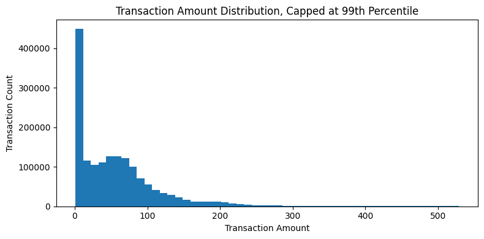

**Figure 3:** Transaction amount distribution capped at the 99th percentile. The feature is strongly right skewed, which influenced the model specific handling of numeric features.

The categorical fields were generally usable, but they still required controlled handling before modeling. The `category` field contained a large missing or undefined group, so missing category values were filled with `"unknown"` instead of dropping those transactions. Merchant values were broadly distributed and high-cardinality, so `merchant` was frequency encoded rather than one-hot encoded into a very wide sparse feature space.

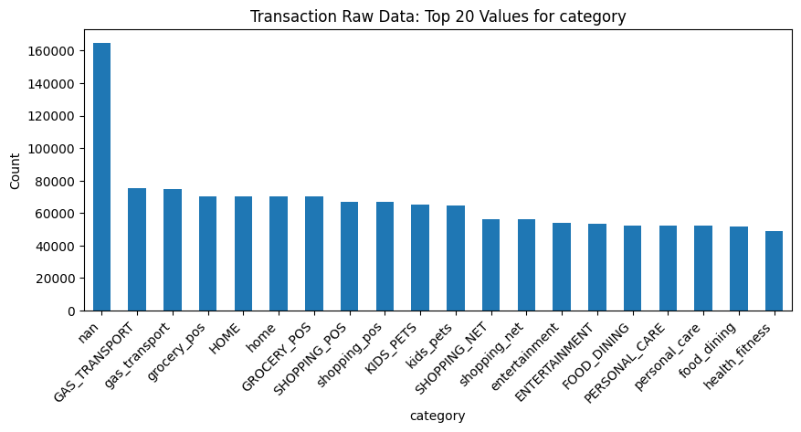

**Figure 4:** Top transaction category values in the raw data. The imbalance and missing category group supported explicit missing value handling and categorical feature encoding.

Customer level fields showed a similar mix of useful context and potential noise. The customer age distribution appeared reasonable after deriving approximate age from `dob`, which supported converting date of birth into an `age` feature rather than using the raw date. The `job` field was sparse, with many job categories represented by only a small number of customers. This made direct one hot encoding less attractive and supported frequency encoding. The `sex` field was relatively balanced, so it was retained as a categorical feature, but it should be interpreted carefully because differences in fraud rate by sex may reflect broader customer and transaction distribution effects rather than a causal relationship.

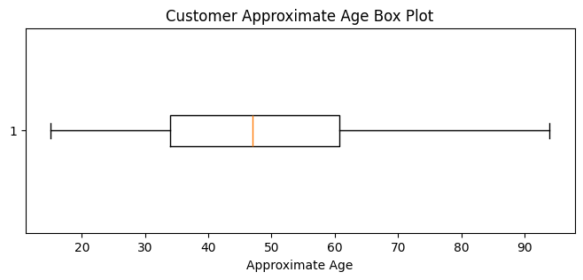

**Figure 5:** Customer approximate age distribution. The field appears usable after transformation from raw date of birth into an age feature.

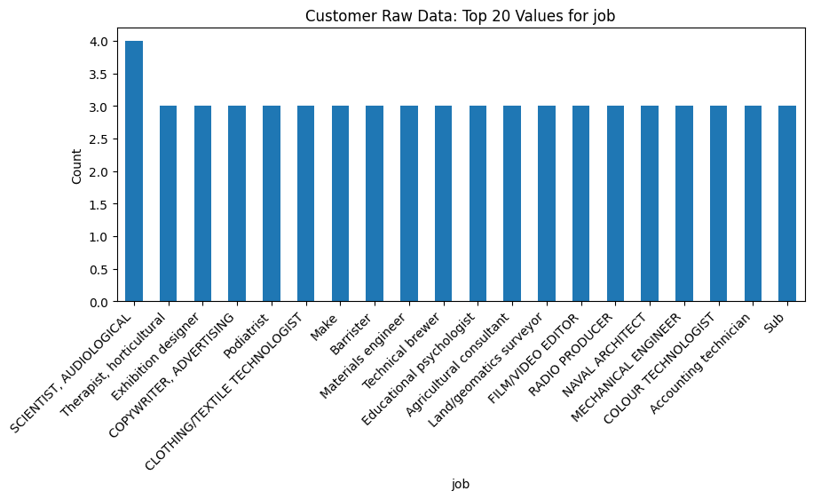

**Figure 6:** Top customer job values. The sparse distribution supports frequency encoding rather than direct high dimensional one hot encoding.

Some fields were useful mainly for identifying limitations rather than for direct model improvement. The `city_pop` feature was highly skewed, with most customers concentrated in smaller population areas and a long tail of very large population values. In addition, the latitude and longitude fields are limited to U.S. based customer and merchant locations. This means location features may help within the current dataset, but they should not be treated as globally generalizable without additional geographic coverage. Distance between customer and merchant locations was explored as an engineered feature, but it appeared less informative than expected during experimentation and should be monitored carefully before relying on it as a core fraud signal.

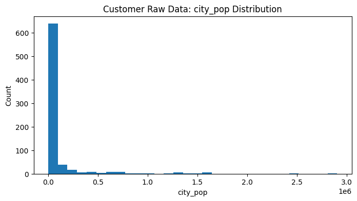

**Figure 7:** Customer city population distribution. The strong skew suggests that `city_pop` may require careful handling or may be less stable as a direct fraud signal.

Overall, the raw data analysis supported three major data design decisions. First, time based features should be extracted because transaction volume varies meaningfully across hour, day, and month. Second, high cardinality categorical fields such as `merchant` and `job` should be encoded carefully to avoid creating sparse and unstable feature spaces. Third, numeric and location based fields should be retained selectively, but interpreted with caution because several of them are skewed, geographically limited, or weaker than expected during experimentation.

#### Preprocessed Data Analysis

After the raw sources were merged and cleaned, the preprocessed dataset was analyzed against the fraud label to identify which features provided useful separation. This analysis was used to connect exploratory findings to practical feature decisions in the adapters.

The most important dataset-level finding was the extreme class imbalance. Fraudulent transactions made up only a small fraction of the full dataset, which means that accuracy alone is not a reliable measure of model quality. A model could achieve high accuracy by predicting most transactions as legitimate while still missing the fraud cases that matter most. This supported the use of precision, recall, F1, balanced accuracy, ROC AUC, and average precision during evaluation.

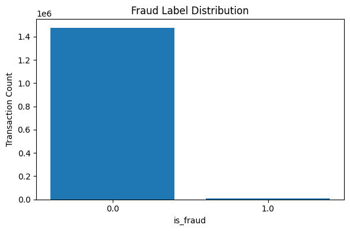

**Figure 8:** Fraud label distribution after preprocessing. Fraud cases represent a very small portion of all transactions, making class-aware evaluation necessary.

Transaction amount showed one of the clearest relationships with fraud. Fraudulent transactions had a higher median amount and a wider spread than legitimate transactions, suggesting that amount is a meaningful transaction-level signal. This supported retaining `amt` in both model workflows. It also helped justify the use of gradient boosting as the default model because tree-based methods can capture nonlinear threshold behavior in skewed numeric fields.

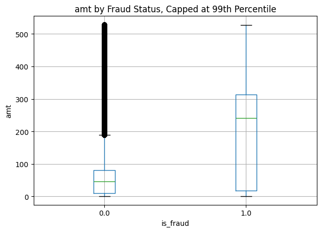

**Figure 9:** Transaction amount by fraud status. Fraudulent transactions show a higher median amount and wider spread, making amount one of the strongest transaction-level signals.

Time-based variables also showed meaningful fraud-rate differences. Fraud rates varied by hour, day of week, and month. The hour-level analysis was especially useful because late-night transactions showed noticeably higher fraud rates than most daytime transactions. This supported the preprocessing decision to convert `trans_date_trans_time` into separate features such as `hour`, `day_of_week`, `day_date`, `month_date`, and `year_date`.

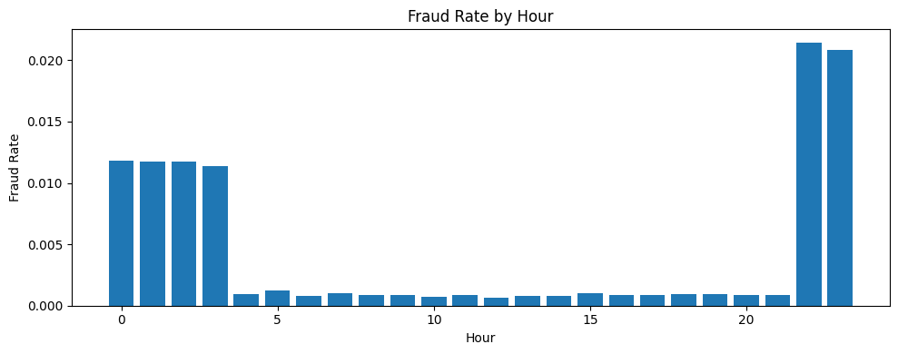

**Figure 10:** Fraud rate by hour. Late-night transaction hours show noticeably higher fraud rates, supporting the use of time-derived features.

Categorical transaction fields provided additional signal, but they required careful handling. Merchant category showed more interpretable fraud-rate differences than individual merchant name. Raw merchant identity is high-cardinality and can be noisy, so the adapters use frequency encoding for `merchant` while retaining `category` as a categorical feature. This keeps useful transaction context without creating an overly wide sparse feature space.

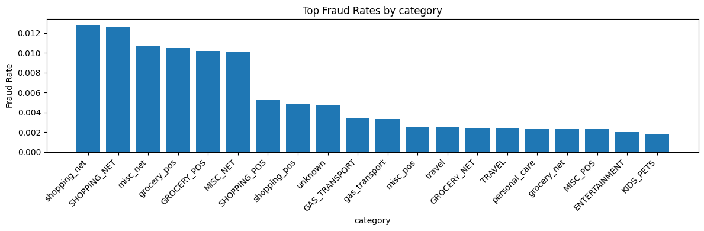

**Figure 11:** Fraud rate by transaction category. Category shows clearer and more interpretable fraud-rate variation than raw merchant identity.

Customer and location features showed mixed value. State showed stronger regional fraud-rate variation than city population, while city population appeared weak as a standalone signal. Customer sex also showed some difference in fraud rate, with male customers showing a higher fraud rate even though they were not the majority group in the raw customer distribution. This signal was retained as a categorical feature, but it should be interpreted carefully and monitored for fairness because it may reflect dataset composition rather than a causal relationship.

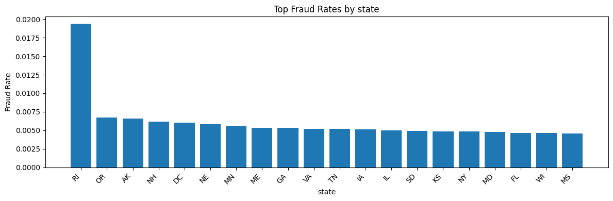

**Figure 12:** Fraud rate by state. Regional variation is visible, supporting the use of state as a compact location-based categorical feature.

Several intuitive features were less useful than expected. Customer-merchant distance showed very similar distributions for legitimate and fraudulent transactions, suggesting that simple geographic distance is weak as a standalone fraud signal. City population also showed relatively flat fraud rates across bins. These findings indicate that location should be represented selectively, with stronger emphasis on categorical regional fields such as `state` rather than relying heavily on distance or population size.

Overall, the preprocessed data analysis identified the strongest feature groups as transaction amount, merchant category, time-derived variables, and selected customer/location fields. It also identified weaker or riskier signals, including simple customer-merchant distance, city population, and high-cardinality city or merchant identifiers. These findings informed the final adapter design by supporting numeric scaling for logistic regression, frequency encoding for high-cardinality fields, categorical encoding for compact fields, and threshold-based evaluation for the rare fraud class.

### Feature Engineering and Adapter Design
The data analysis informed the final feature implementation used by the model adapters. After the shared preprocessing pipeline creates a clean transaction-level dataset, the adapters convert that dataset into model-ready features. This design keeps common data cleaning separate from model-specific feature decisions.

Both model adapters remove fields that are identifiers, personally descriptive, overly granular, or weak based on analysis. Dropped fields include transaction/customer identifiers, names, street address, city, ZIP code, raw merchant name, minute, seconds, and city population. Identifiers such as `cc_num` and `trans_num` are useful for merging and tracking records, but they should not be used directly as predictive model features. Customer name and street fields were removed because they are not appropriate modeling signals and could introduce privacy or memorization risk. City and merchant were also removed as raw fields because they are high-cardinality and noisy. City population was removed because the fraud-rate analysis showed weak separation across population bins.

The adapters then create several derived features supported by the analysis. Date of birth is converted into an approximate `age` feature, which is more model-ready than the raw `dob` value. Transaction timing is represented through features such as `hour`, `day_of_week`, `month_date`, `minute_of_day`, `is_night`, `is_evening`, and `is_weekend`. These choices are supported by the observed fraud-rate differences across hour, day, and month. The adapters also create time-delta features from `cc_num` and `unix_time`, including `minutes_since_previous_transaction` and repeat-window indicators for transactions occurring within 5 minutes, 30 minutes, and 1 hour. This was included because the analysis showed elevated fraud rates for short gaps between transactions.

Categorical variables are handled based on their cardinality and usefulness. Compact categorical fields such as `category`, `sex`, `state`, `day_of_week`, and `month_date` are one-hot encoded. The `job` field is frequency encoded because it is high-cardinality and sparse. Frequency encoding allows the model to use information about how common a job group is without creating a very wide sparse matrix. Raw `merchant` was dropped in the final adapter design because the merchant-level relationship appeared noisier and less stable than category-level behavior.

The two adapters share the same general feature logic, but they differ where the model type requires it. The logistic regression adapter scales numeric features using `StandardScaler` because linear models are sensitive to feature magnitude. Its numeric feature set includes amount, coordinates, time features, age, job frequency, transaction time-delta values, and behavioral time flags. The gradient boosting adapter does not scale numeric features because tree-based boosting models are not sensitive to numeric scale in the same way. This keeps the boosting pipeline simpler while preserving the same engineered signal groups.

Prediction-time feature alignment is also handled inside the adapters. During training, each adapter stores the final feature column list. During prediction, incoming transaction data is transformed and then reindexed to match the training feature columns, with missing columns filled as zero. This is important because one-hot encoding can create different columns depending on the values present in a single prediction request. Feature alignment ensures that the deployed model receives the same schema it saw during training.

Dataset quality is enforced before the adapter stage. The raw data handler checks that source files can be loaded, normalizes transaction identifiers, attaches fraud labels, merges customer data, drops duplicate transactions, and removes rows missing required fields. The preprocessing pipeline validates required training fields such as `cc_num`, `amt`, `trans_date_trans_time`, and `is_fraud`, while prediction inputs are validated against required inference fields. Optional fields such as `merchant`, `category`, `unix_time`, `merch_lat`, and `merch_long` are filled with controlled defaults instead of allowing uncontrolled missing values to reach the model.

The dataset generation workflow also returns a quality summary containing row count, column count, missing-value count, fraud label counts, fraud rate, duplicate transaction count, unique transaction count, and unique customer count. This provides a practical checkpoint before training and makes the data pipeline more auditable. In the latest generated dataset, the final training dataset contained no missing values, no duplicate transactions, 750 unique customers, 1,482,872 unique transactions, and a fraud rate of approximately 0.44 percent.

## Model Design
### Candidate Model Strategy

The SecureBank model layer was designed to support more than one modeling approach. Instead of hardcoding one estimator directly into the API, the system uses a model wrapper and model-specific adapters. This allows logistic regression and gradient boosting to share the same preprocessing, training orchestration, prediction workflow, and evaluation logic while still allowing each model to receive the feature format it needs.

The model strategy was to compare a simple baseline model against a more flexible nonlinear model. Logistic regression provides a fast and interpretable benchmark for binary classification. Gradient boosting provides a stronger candidate for the final deployed workflow because fraud behavior can depend on nonlinear relationships between amount, time, category, customer attributes, and regional context.

The model analysis supported this strategy. Logistic regression was useful for validating the feature pipeline and establishing a baseline, but its performance was less responsive to later feature engineering changes. Gradient boosting showed stronger fraud detection performance and a better precision-recall balance during threshold testing, so it was selected as the default model for deployment.

### Logistic Regression Baseline

Logistic regression was implemented as the baseline model because it is simple, efficient, and useful for establishing whether the engineered dataset contains measurable fraud signal. Since it produces probability scores, it also allowed the system to test different decision thresholds and observe how precision, recall, and false positive volume changed across operating points.

The logistic regression model was configured as a practical baseline rather than as the final high-complexity model. The implementation used a higher maximum iteration limit to give the optimizer enough room to converge on the large dataset, along with class balancing to compensate for the severe class imbalance between legitimate and fraudulent transactions. This was important because fraud represented only a very small fraction of the training data, and an unweighted logistic regression model would be biased toward predicting the majority class.

The logistic regression results showed that the model did learn some separation between fraudulent and legitimate transactions. At lower thresholds, recall was high, meaning the model was able to identify many fraud cases. For example, at threshold `0.40`, recall reached `0.857`, and at threshold `0.50`, recall remained strong at `0.789`. This confirmed that the feature pipeline was not random and that the dataset contained usable predictive signal.

However, the same results also showed the main limitation of logistic regression for this problem. The model only achieved high recall by producing a very large number of false positives. At threshold `0.40`, the model generated `22,641` false positives with precision of only `0.024`. At threshold `0.50`, false positives dropped to `14,596`, but precision was still only `0.034`. In a banking workflow, this would create too much review burden and too many unnecessary customer interruptions.

| Threshold | Accuracy | Balanced Accuracy | Precision | Recall | F1 | False Positives | False Negatives |
|---:|---:|---:|---:|---:|---:|---:|---:|
| 0.40 | 0.847 | 0.852 | 0.024 | 0.857 | 0.047 | 22,641 | 93 |
| 0.50 | 0.901 | 0.845 | 0.034 | 0.789 | 0.065 | 14,596 | 137 |
| 0.70 | 0.970 | 0.842 | 0.098 | 0.714 | 0.172 | 4,286 | 186 |
| 0.85 | 0.988 | 0.804 | 0.204 | 0.618 | 0.307 | 1,571 | 248 |
| 0.90 | 0.990 | 0.758 | 0.216 | 0.525 | 0.306 | 1,236 | 309 |
| 0.99 | 0.993 | 0.625 | 0.244 | 0.254 | 0.249 | 512 | 485 |

**Table 1:** Representative logistic regression threshold results. Logistic regression captured some fraud signal, but did not produce a strong enough precision-recall balance for deployment.

As the threshold increased, logistic regression became more conservative. Precision improved from `0.024` at threshold `0.40` to `0.244` at threshold `0.99`, but recall dropped from `0.857` to `0.254`. The best F1 region occurred around thresholds `0.85` and `0.90`, but recall was already below the project target in that range. At threshold `0.70`, recall was close to the target at `0.714`, but precision was still only `0.098`.

Further logistic regression improvement would likely require more targeted feature engineering or hyperparameter tuning. Possible improvements include testing different regularization strengths, comparing L1 and L2 penalties, using interaction features, applying transformations to skewed numeric variables, calibrating probabilities, or using more advanced resampling and class-weight strategies. However, because the baseline results remained far below the required precision-recall balance, the project shifted effort toward gradient boosting, which was a better match for the nonlinear and interaction-heavy structure of the data.

Overall, logistic regression accomplished its purpose as a baseline. It demonstrated that the cleaned and engineered data contained usable fraud signal, provided a clear precision-recall trade-off curve, and established a benchmark for the more flexible model. Its shortcoming was that it could not reach a practical operating point where both fraud capture and false positive control were strong enough. For that reason, it was retained as a baseline rather than selected as the default model.

### Gradient Boosting Default Model

Gradient boosting was selected as the default model family because it better matched the structure of the SecureBank fraud detection problem. Unlike logistic regression, gradient boosting can capture nonlinear relationships, threshold effects, and feature interactions without requiring every interaction to be manually specified. This was important because the data analysis showed that fraud behavior depends on mixed transaction, customer, category, time, and location signals rather than one simple linear pattern.

The gradient boosting experiments were performed in stages. Instead of running a large uncontrolled grid search, the tuning process changed one major modeling decision at a time, selected the best result from that stage, and then used that configuration as the starting point for the next stage. This made the tuning process easier to interpret and reduced the risk of selecting a model configuration without understanding why it improved.

The first gradient boosting configuration already outperformed logistic regression. With the initial setup, the best staged result achieved `0.854` precision, `0.718` recall, and `0.780` F1 at threshold `0.90`. This was already a major improvement over the logistic regression baseline because it produced much higher precision while keeping recall above the project target. The staged tuning process then improved the model further by adjusting the learning schedule, tree capacity, and regularization.

| Stage | Main Tuning Decision | Selected Value | Threshold | Precision | Recall | F1 | Average Precision |
|---|---|---:|---:|---:|---:|---:|---:|
| Initial GB | Base configuration | Base model | 0.90 | 0.854 | 0.718 | 0.780 | 0.758 |
| Learning schedule | `learning_rate`, `max_iter` | `0.02`, `400` | 0.50 | 0.937 | 0.754 | 0.835 | 0.889 |
| Tree capacity | `max_leaf_nodes` | `63` | 0.50 | 0.940 | 0.775 | 0.850 | 0.903 |
| Leaf size | `min_samples_leaf` | `20` | 0.50 | 0.940 | 0.775 | 0.850 | 0.903 |
| Regularization | `l2_regularization` | `0.5` | 0.50 | 0.944 | 0.777 | 0.852 | 0.903 |
| Final training run | Tuned model and expanded threshold sweep | `0.60` | 0.60 | 0.966 | 0.740 | 0.838 | 0.903 |

**Table 2:** Staged gradient boosting tuning results. The tuning process improved the model from the initial gradient boosting configuration and identified a stronger final operating threshold.

The staged results show that the largest improvement came from the learning schedule. Reducing the learning rate to `0.02` and increasing the number of boosting iterations to `400` improved F1 from `0.780` to `0.835` and average precision from `0.758` to `0.889`. This suggests that the model benefited from slower, more gradual boosting rather than a smaller number of larger updates.

Increasing `max_leaf_nodes` to `63` provided another improvement, raising F1 to approximately `0.850`. This indicates that the model needed enough tree capacity to capture useful interactions between amount, time, category, customer, and location features. The `min_samples_leaf` stage did not materially improve the result beyond the existing value of `20`, so the original setting was retained. Adding `l2_regularization = 0.5` produced the strongest staged F1 result at threshold `0.50`, with approximately `0.944` precision, `0.777` recall, and `0.852` F1.

After the model parameters were selected, the training workflow was updated to evaluate a wider threshold range. This was important because the previous threshold list was concentrated at very high thresholds, which favored precision but reduced recall. With the expanded threshold sweep, the final training run selected threshold `0.60`, achieving approximately `0.966` precision, `0.740` recall, and `0.838` F1 on validation. This threshold met the project requirement of at least 70 percent precision and 70 percent recall while maintaining very strong false positive control.

The final tuned gradient boosting configuration is therefore stronger than the earlier smoke-tested model. The earlier run selected a very high threshold, which produced strong precision but weaker recall. After updating the default gradient boosting parameters and widening the threshold sweep, the deployed training workflow selected a more balanced operating threshold of `0.60`. This aligned the final default model with the project requirement and improved the held-out test result to approximately `0.960` precision, `0.728` recall, and `0.828` F1.

Overall, gradient boosting was selected because it achieved the best practical fraud detection trade-off. It produced high precision, met the recall target after tuning, and handled nonlinear feature behavior better than logistic regression. The main trade-off is that it is less directly interpretable, so it requires stronger monitoring after deployment, including threshold monitoring, false positive tracking, false negative review, drift checks, and periodic retraining.

### Threshold Selection and Model Trade-offs

The system treats fraud detection as a probability-based classification problem. The model outputs a fraud probability, and the selected threshold converts that probability into a final `legitimate` or `fraudulent` decision. This threshold is a core design choice because fraud detection has an asymmetric cost structure. A low threshold catches more fraud but can create many false positives, while a high threshold reduces false positives but may miss more fraudulent transactions.

The initial threshold range was too conservative because it focused mostly on high thresholds. This produced very strong precision but limited recall. After the threshold list was expanded to include lower and mid-range values, the tuned gradient boosting model selected threshold `0.60` using the rule of highest F1 while meeting minimum precision and recall constraints.

This final threshold produced the best deployment-oriented balance in the latest run. On validation, the model achieved approximately `0.966` precision, `0.740` recall, and `0.838` F1. On the held-out test set, it achieved approximately `0.960` precision, `0.728` recall, and `0.828` F1. This shows that the selected threshold is not only a modeling result, but also an operational decision that balances fraud capture with review burden.

The main trade-off is that the selected threshold still misses some fraud cases, as shown by the false negatives in the validation and test results. However, lowering the threshold further would increase the number of false positives and could create more manual review burden. For this prototype, the selected threshold is appropriate because it satisfies the required precision and recall targets while maintaining high overall model quality.

## Performance Metrics
### Offline Performance Evaluation

The SecureBank model was evaluated using offline metrics that are appropriate for rare-event fraud detection. Fraudulent transactions represent only a very small portion of the dataset, so standard accuracy is not reliable as a primary metric. A model could classify almost every transaction as legitimate and still report high accuracy while failing to detect the fraud cases that matter most. For that reason, accuracy was reported for completeness, but it was not used to drive model selection.

The most important offline metrics were precision, recall, and F1 score. Precision measures how many transactions flagged as fraud were actually fraudulent. This is important operationally because low precision would create unnecessary manual review workload and could disrupt legitimate customers. Recall measures how many actual fraud cases the model detected. This is important because low recall means the system is missing fraud. F1 score was used as the main threshold-selection metric because it combines precision and recall into a single value, which is useful when both false positives and false negatives matter.

Balanced accuracy, ROC AUC, and average precision were also included, but they served different purposes. Balanced accuracy helped account for the extreme class imbalance by considering performance on both the legitimate and fraud classes. ROC AUC measured how well the model ranked fraudulent transactions above legitimate ones across thresholds. Average precision was especially useful because it summarizes precision-recall behavior and is more informative than accuracy when the positive class is rare.

Each metric has limitations. Accuracy was weak because it was dominated by the legitimate class. Precision alone could favor a model that flags very few transactions but is usually correct when it does. Recall alone could favor a model that catches many fraud cases but produces too many false positives for a practical banking workflow. ROC AUC can look strong even when the selected decision threshold is not operationally useful. Because of these limitations, the final model was selected using a constrained threshold rule: choose the highest validation F1 score while requiring both precision and recall to meet the project target.

The project target was at least 70 percent precision and 70 percent recall. This made model selection an operating-point problem, not just a model-ranking problem. The selected model needed to identify fraud at a meaningful rate while keeping false positives low enough for a realistic review process. Logistic regression provided a useful baseline because it showed that the engineered data contained fraud signal, but it could not reach a practical precision-recall balance. Gradient boosting performed better because it captured nonlinear relationships and interactions more effectively.

| Model | Threshold | Precision | Recall | F1 | Design Interpretation |
|---|---:|---:|---:|---:|---|
| Logistic Regression | 0.70 | 0.098 | 0.714 | 0.172 | Recall was near target, but precision was too low for deployment |
| Logistic Regression | 0.85 | 0.204 | 0.618 | 0.307 | Better F1 region, but recall fell below target |
| Gradient Boosting, Initial | 0.90 | 0.854 | 0.718 | 0.780 | Met the target and clearly outperformed logistic regression |
| Gradient Boosting, Tuned | 0.60 | 0.966 | 0.740 | 0.838 | Best final validation balance while meeting both project targets |

**Table 3:** Representative offline model comparison. Logistic regression provided a useful baseline, while tuned gradient boosting produced the strongest precision-recall balance.

The final tuned gradient boosting model selected a threshold of `0.60`. This threshold was selected because it produced the best validation F1 score among thresholds that met the minimum precision and recall constraints. The validation and held-out test results are shown below.

| Split | Threshold | Accuracy | Balanced Accuracy | Precision | Recall | F1 | ROC AUC | Average Precision | False Positives | False Negatives |
|---|---:|---:|---:|---:|---:|---:|---:|---:|---:|---:|
| Validation | 0.60 | 0.9987 | 0.8699 | 0.9659 | 0.7400 | 0.8380 | 0.9976 | 0.9026 | 17 | 169 |
| Test | 0.60 | 0.9987 | 0.8641 | 0.9604 | 0.7283 | 0.8284 | 0.9966 | 0.9018 | 39 | 353 |

**Table 4:** Final tuned gradient boosting performance on validation and held-out test splits.

The final results show that the model met the project requirement on both validation and test data. Precision stayed above `0.96`, meaning that most transactions flagged as fraudulent were truly fraud. Recall stayed above `0.72`, meaning the model captured a meaningful share of fraud cases while still controlling false positives. The high ROC AUC and average precision values show that the model also ranked fraud risk well beyond the selected threshold.

The false positive and false negative counts provide the most practical interpretation of the model. On the held-out test split, the model produced `39` false positives and `353` false negatives while detecting `946` true fraud cases. This means the chosen threshold keeps review burden low while still identifying a substantial portion of fraud. A lower threshold could increase recall, but it would likely increase false positives. A higher threshold could reduce false positives, but it would miss more fraud. The selected threshold therefore represents a reasonable operating point for this prototype.

Overall, the offline evaluation influenced the final design in two important ways. First, it confirmed that gradient boosting should be the default model rather than logistic regression. Second, it showed that threshold selection must be part of the training workflow because the model probability score alone does not determine business behavior. For this reason, the selected threshold is saved with the model metadata and used by the prediction service during inference.

### Online Performance Measurement

Online performance measurement is needed because fraud detection performance can change after deployment. Offline metrics show that the model performs well on held-out historical data, but production behavior may shift as customers change spending habits, merchants change transaction patterns, or fraud strategies evolve. For that reason, SecureBank should monitor model effectiveness, customer impact, data drift, and system reliability after deployment.

The online measurement plan focuses on four metric groups. First, SecureBank should track fraud workflow effectiveness, including fraud flag rate, confirmed fraud rate, true positive alerts, false positive alerts, missed fraud cases, and manual review volume. These metrics show whether the model is producing useful fraud alerts or simply adding review workload. Second, SecureBank should track customer impact, including customer complaint rate related to fraud flags, appeal or dispute rate, transaction hold rate, percentage of flagged transactions later cleared as legitimate, and average review resolution time. These metrics are important because a fraud model can perform well statistically while still creating unacceptable friction for legitimate customers.

Third, SecureBank should track model drift and degradation. Feature drift should be measured by comparing production feature distributions against training distributions for important fields such as `amt`, `hour`, `category`, `state`, merchant behavior, and predicted fraud probability. Prediction drift should be measured through changes in fraud flag rate and average fraud probability. Label drift should be measured through changes in confirmed fraud rate once final outcomes are available. Fourth, SecureBank should track system reliability metrics such as API request volume, prediction latency, error rate, invalid request rate, preprocessing failures, model loading failures, and logging failures. These metrics ensure that the model is not only accurate, but also available and usable in the transaction workflow.

The main online model metrics would be calculated after confirmed fraud outcomes become available. Fraud outcomes are often delayed because transactions may only be confirmed through manual review, customer dispute, chargeback, or investigation. For that reason, online metrics should be calculated over rolling time windows, such as weekly or monthly reporting periods.

```text
online_precision = confirmed_true_fraud_flags / total_model_fraud_flags_with_final_outcome
```

```text
online_recall = confirmed_true_fraud_flags / total_confirmed_fraud_transactions
```

```text
false_positive_rate = confirmed_legitimate_fraud_flags / total_confirmed_legitimate_transactions
```

```text
false_negative_rate = missed_fraud_transactions / total_confirmed_fraud_transactions
```

Customer impact metrics would be calculated from review and customer service outcomes. The customer complaint rate can be calculated as the number of fraud-flag-related complaints divided by the total number of flagged transactions. The appeal or dispute rate can be calculated as the number of challenged fraud decisions divided by the total number of fraud flags. The legitimate-clearance rate can be calculated as the number of flagged transactions later confirmed legitimate divided by the total number of flagged transactions with final outcomes. Average review resolution time can be calculated as the average time between a fraud flag and the final review decision.

Drift metrics would be calculated by comparing current production distributions to the training baseline. For example, SecureBank can compare average transaction amount, transaction amount percentiles, hourly transaction distribution, category mix, state distribution, fraud flag rate, and average predicted fraud probability across time windows. Large changes in these values would indicate that the model may be operating on data that differs from the data used during training. When drift is detected, the model should be flagged for threshold review, retraining, or deeper feature analysis.

To support these calculations, each prediction event should store a limited operational record. This record should include a transaction identifier, timestamp, model version, selected threshold, predicted label, fraud probability, response status, and prediction latency. When the final fraud outcome becomes available, that outcome should be joined back to the prediction record using the transaction identifier. Review outcomes should also record whether the transaction was confirmed fraud, confirmed legitimate, disputed, appealed, or still pending.

The information collection policy should follow a minimum necessary data principle. Routine monitoring does not require storing full names, street addresses, or unnecessary customer details. The system should store only the fields needed to calculate model performance, drift, customer impact, and reliability metrics. Sensitive customer fields should be excluded from routine logs unless they are needed for controlled investigation. Access to prediction logs, review outcomes, and fraud labels should be restricted to authorized administrators or analysts.

This online measurement plan supports both model governance and operational decision-making. It allows SecureBank to determine whether the model continues to meet precision and recall goals, whether it creates too much customer friction, whether production data has drifted from the training baseline, and whether the deployed API remains reliable enough for fraud detection workflows.

## Deployment Strategy & Post-Deployment Monitoring
### Deployment Strategy

The SecureBank system is deployed as a Dockerized Flask API. Docker was used to make the runtime environment consistent across machines and to reduce dependency issues during testing or deployment. The API exposes the main system workflows through `/predict`, `/create_dataset`, and `/train_model`, while the provided executable scripts allow administrators to build the server, generate datasets, train models, and run sample predictions from the command line.

The deployment workflow is designed around saved model artifacts and metadata. When `/train_model` is called, the system trains the configured model, evaluates candidate thresholds, saves the trained model as a versioned `.joblib` file, writes model metadata, and updates the default model reference used by `/predict`. This allows prediction to stay separate from training. The prediction endpoint does not retrain the model; it loads the registered default model and selected threshold, preprocesses the incoming transaction, and returns a fraud decision.

This design supports repeatable deployment because the same preprocessing, model wrapper, adapter, and threshold metadata are used during inference. It also supports future model updates because a newly trained model can replace the default model reference without rewriting the prediction endpoint. In a production environment, the same pattern could be extended by storing model artifacts in a managed model registry or cloud storage service.

### Logging and Error Handling

The system uses structured JSON logging to support monitoring and debugging. Dataset generation, training, prediction, and error events can be written as timestamped log records. These logs should include the endpoint name, request metadata, response metadata, workflow status, error message when applicable, and relevant model metadata such as model type, model path, threshold, and prediction output.

Model error handling is important because failures can occur at several stages. During prediction, an incoming request may be missing required fields, contain invalid values, reference a customer that cannot be found, fail preprocessing validation, or encounter a model loading issue. The system should return a clear JSON error response instead of failing silently. During training, errors may occur because raw data files are missing, required columns are unavailable, labels are invalid, or the model cannot be saved. These failures should be logged with enough detail for administrators to diagnose the issue.

The logging design should separate operational monitoring from sensitive customer data. Routine logs should not store unnecessary personal details such as names or street addresses. Instead, logs should focus on transaction identifiers, timestamps, model version, selected threshold, fraud probability, prediction label, response status, and error details. This keeps the system auditable while reducing unnecessary exposure of customer information.

### Drift Detection and Model Degradation Monitoring

After deployment, the model should be monitored for concept drift and performance degradation. Fraud detection is especially sensitive to drift because customer behavior, merchant behavior, transaction volumes, and fraud strategies can change over time. A model that performs well on historical data may become less reliable if production data begins to look different from the training data.

Feature drift should be monitored by comparing production feature distributions against the training baseline. Important fields to track include transaction amount, hour of day, day of week, category, state, merchant behavior, and predicted fraud probability. For example, if the distribution of transaction amounts or transaction categories shifts significantly, the model may be receiving data that differs from what it learned during training.

Prediction drift should be monitored by tracking fraud flag rate, average fraud probability, and the distribution of model scores over time. A sudden increase in fraud flags may indicate changing fraud behavior, data quality issues, or a preprocessing problem. A sudden decrease may indicate that the model is becoming too conservative or that incoming data no longer matches the training distribution.

Model degradation should be monitored once confirmed fraud labels become available. SecureBank should track online precision, recall, false positives, false negatives, confirmed fraud rate, and customer-impact metrics such as complaint rate or dispute rate. If recall drops below the target, if false positives increase sharply, or if customer complaints rise, the threshold should be reviewed and the model may need retraining.

Retraining should be triggered when monitoring shows meaningful degradation or drift. Possible retraining triggers include a sustained drop in online recall, a major increase in false positives, a large shift in feature distributions, a change in confirmed fraud rate, or a scheduled refresh after enough new labeled transactions have been collected. The retraining workflow can reuse the existing `/create_dataset` and `/train_model` endpoints to generate updated data, train a new model, evaluate threshold candidates, and register a new default model.

Overall, the deployment and monitoring strategy is designed to keep the model reliable after release. Docker provides a consistent runtime, model metadata controls which artifact is used for prediction, JSON logs support diagnosis and auditing, and drift monitoring provides a path for threshold review and retraining when production behavior changes.
